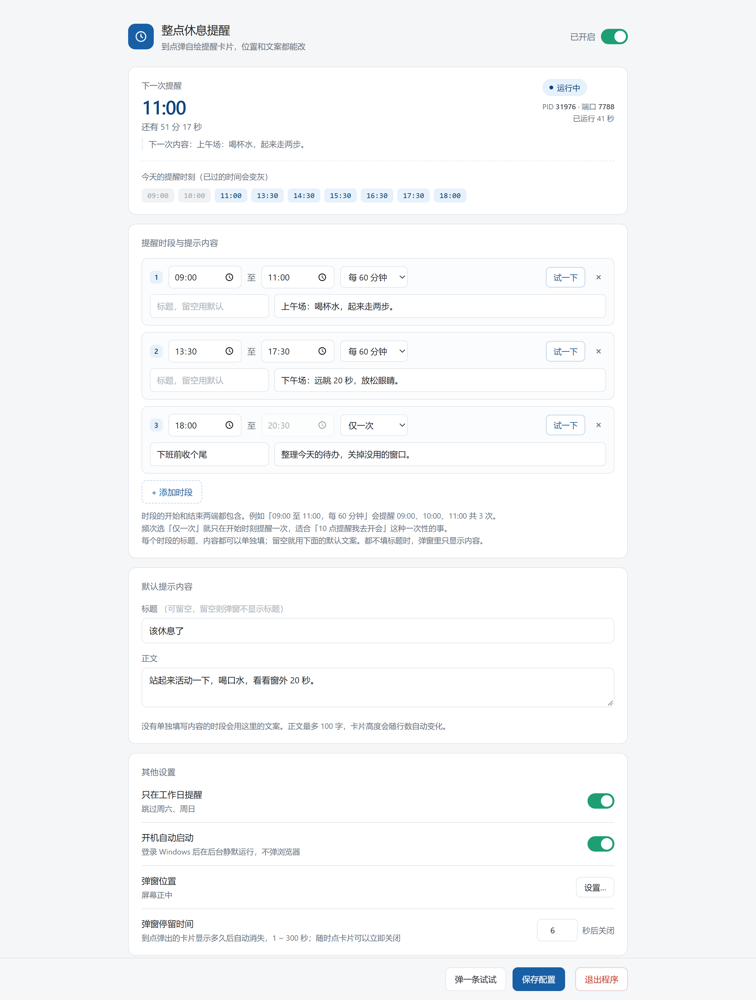

# RestReminder · 整点休息提醒

> 到点在自己桌面上弹一张卡片，提醒你站起来活动一下。**单个 exe、零依赖、不走系统通知中心。**

[](LICENSE)
[](#系统要求与兼容性)
[](#从源码编译)
[](https://github.com/wangjianghuan/windows-reminder/releases)

上学时有上下课铃，上班以后就没人提醒你起来了。这个小工具按你配的时刻表，在自己桌面上弹一张小卡片——不是系统通知，是它自己画的窗口，所以"专注助手""勿扰模式""通知权限"这些开关都影响不到它，只要进程活着就一定会出现。

配置全部在浏览器页面里改（页面本身就是程序的一部分，编译时嵌进 exe 了），改完立刻生效，不用重启。



> 上面这张就是配置页面本体。上面是下一次提醒和今天的时刻表，中间是每个时段自己的标题和内容，下面是默认文案、工作日开关、开机自启和弹窗位置。

---

## 目录

- [特性](#特性)
- [下载与运行](#下载与运行)
- [配置页面怎么用](#配置页面怎么用)
- [弹窗长什么样](#弹窗长什么样)
- [从源码编译](#从源码编译)
- [系统要求与兼容性](#系统要求与兼容性)
- [配置文件字段](#配置文件字段)
- [把工具发给别人](#把工具发给别人)
- [代码结构](#代码结构)
- [几个值得说的实现细节](#几个值得说的实现细节)
- [测试](#测试)
- [已知限制](#已知限制)

## 特性

| 特性 | 说明 |
|---|---|
| 自绘弹窗 | Win32 分层窗口 + 逐像素渲染，圆角、阴影、抗锯齿都是自己算的；**不依赖通知中心 / WinRT / XAML** |
| 多时段 | 想配几段配几段，比如上午一场、下午一场，午休时段直接不配即可 |
| 每段独立文案 | 每个时段可以有自己的标题和内容，留空则回落到默认文案 |
| 标题可留空 | 标题留空时弹窗里**整块标题不显示**，卡片自动变矮，只剩一句话 |
| 频次灵活 | 「每 N 分钟」或「**仅一次**」（适合"10 点提醒我去开会"这种一过性的事） |
| 九个弹窗位置 | 屏幕九宫格的任意一格，相对工作区计算，天然避开任务栏 |
| 停留时长可调 | 弹窗显示 1~300 秒后自动消失，默认 6 秒；点一下卡片可以立即关掉 |
| 工作日模式 | 跳过周六周日 |
| 开机自启 | 页面上一个开关，写当前用户注册表，不需要管理员权限 |
| 配置热生效 | 页面保存即生效，记事本改 `config.json` 才需要重启 |
| 绿色免安装 | 一个 exe + 一个 `config.json`，删掉即卸载，不写注册表（除非你开了自启） |

## 下载与运行

到 [Releases](https://github.com/wangjianghuan/windows-reminder/releases) 下载 `restreminder.exe`，**放到一个你能写文件的目录**（桌面、`D:\tools\` 都行，别放 `C:\Program Files`——那里普通用户没写权限，`config.json` 建不出来），双击它。

第一次运行会发生三件事，任意一件都能让你确认「程序起来了」：

1. 弹出一个控制台窗口，里面滚动着提醒日志（关掉它等于结束程序）
2. 自动在默认浏览器打开配置页面 `http://127.0.0.1:7788`
3. 在桌面上弹一张「提醒已启动 · 下次 16:30」的小卡片

首次运行还会在 exe 旁边自动生成 `config.json`，默认是 **9:00–11:00、13:30–20:30 各每 60 分钟**，跳过周末。

### 命令行参数

```bash
restreminder.exe                     # 启动 + 打开浏览器 + 弹启动卡片
restreminder.exe -no-browser         # 启动但不打开浏览器、不弹启动卡片
restreminder.exe -silent             # 静默启动：连控制台窗口也藏起来（开机自启用的就是它）
restreminder.exe -port 9000          # 换一个端口
restreminder.exe -preview a.png      # 把当前文案渲染成 PNG 后退出（调版式用，不弹窗）
restreminder.exe -preview b.png -preview-no-title   # 渲染「没有标题」的版式
```

### 怎么退出

| 方式 | 说明 |
|---|---|
| **页面底部「退出程序」按钮** | 最推荐。二次确认后进程正常退出，页面会提示"可以关掉了" |
| 控制台里按 `Ctrl+C` | 和上面等价 |
| 关掉控制台窗口 | 直接杀进程，提醒立即停止 |
| 任务管理器结束 `restreminder.exe` | 兜底 |

**关掉浏览器标签页不会退出程序**，提醒还在继续——配置页面只是个遥控器，这正是想要的行为。

### 重复双击会怎样

如果程序已经在跑，再双击一次**不会**报错，也不会起第二个：

```
[提醒] 程序已经在运行了，不用再启动一个。
[提醒] 配置页面：http://127.0.0.1:7788
```

它会直接把已经在跑的那个配置页面打开给你，然后安静退出，原来的时刻表不受影响。

### 端口被别的程序占了

按顺序往后试 20 个端口，找到能用的就用，日志里会写明：

```
[提醒] 端口 7788 已被别的程序占用，本次改用 7789（下次仍会先试 7788）
```

连 21 个端口都试不通时会明确报错并**把窗口停住**（等你按回车才关），不会出现"窗口闪一下就没了、不知道为什么"。

## 配置页面怎么用

### 提醒时段与提示内容

```
[1] 09:00 至 11:00  每 60 分钟          [试一下] [×]
    [ 标题，留空用默认 ] [ 上午场：喝杯水，起来走两步。   ]
[2] 13:30 至 17:30  每 60 分钟          [试一下] [×]
    [ 下午场           ] [ 远眺 20 秒，放松眼睛。         ]
[3] 18:00 至 20:30  仅一次               [试一下] [×]
    [ 下班前收个尾     ] [ 整理今天的待办，关掉没用的窗口。 ]
```

- 填了就用这段自己的文案；**留空就回落到「默认提示内容」**，所以「所有时段共用一条」的用法照样成立。
- **标题两处都留空，弹窗里就完全不显示标题**——卡片自动变矮，正文顶上到原来标题的位置，只剩一句正文。
- 每段的「试一下」按钮会用**该段还没保存的当前内容**直接弹一次，改完不用先保存就能看效果。
- 正文最多 100 字（约 8 行），标题最多 40 字；卡片高度会随行数自动变化。
- **时段两端都包含**：`09:00 至 11:00 每 60 分钟` 会提醒 09:00、10:00、11:00 三次。不希望终点那一刻也提醒，就把结束时间挪前一分钟（`10:59`）。

### 频次：每 N 分钟 / 仅一次

| 频次 | 行为 |
|---|---|
| 每 60 分钟（09:00–11:00） | 09:00、10:00、11:00 各提醒一次 |
| 仅一次（09:00–11:00） | 只在 **09:00** 提醒一次，之后再也不会在这段里提醒 |

「仅一次」适合「10 点提醒我去开会」这种一过性的事。结束时间对它没有意义（页面上会灰掉），留着只是为了和其他时段保持一致的编辑方式。错过那一刻也不补发——这是「一次性」该有的行为。

### 弹窗位置

位置不常用，所以没占主页面的位置：在「其他设置」里点 **弹窗位置 → 设置…**，弹出九宫格选一格：

```
左上   上中   右上
左中   正中   右中
左下   下中   右下
```

- 九宫格相对**工作区**计算（工作区已排除任务栏），贴底不会压到任务栏。
- 贴边的位置留 24px 边距；「正中」就是工作区几何中心。
- 弹窗里的「预览效果」按钮会立刻在桌面上弹一张卡片，位置对不对一眼就知道。
- 「取消」回滚到打开弹窗之前的位置，「应用」才写进配置。

### 其他设置

| 项 | 说明 |
|---|---|
| 只在工作日提醒 | 跳过周六周日 |
| 开机自动启动 | 打开即生效，写 `HKCU\...\Run`，**不需要管理员权限**；关闭是删掉该值 |
| 弹窗位置 | 见上一节 |
| 弹窗停留时间 | 到点弹出的卡片显示几秒后自动消失，1 ~ 300 秒，默认 6 秒。随时点卡片可以立即关闭 |

开机自启写入的是：

```
HKEY_CURRENT_USER\Software\Microsoft\Windows\CurrentVersion\Run
    RestReminder = "<exe 全路径>" -silent
```

- 用的是 `-silent`：登录后安静跑在后台，不弹控制台、不开浏览器、不弹启动卡片。
- 程序被挪到别的目录**不用手动改注册表**，每次启动都会按当前 exe 的真实路径重写。
- 写注册表失败（被安全软件拦等）时，页面开关会**自动弹回原位**并提示原因，不会出现"显示开了其实没开"。
- 核对是否生效：

```powershell
(Get-ItemProperty 'HKCU:\Software\Microsoft\Windows\CurrentVersion\Run').RestReminder
```

## 弹窗长什么样

| 居中 · 带标题 | 居中 · 标题留空 |
|---|---|
|  |  |

| 居中 · 两行文案（自动变高） | 停靠右下角 |
|---|---|
|  |  |

这几张是程序自己渲染出来的真实像素（`-preview` 走的是和弹窗**完全相同**的绘制代码），和屏幕上看的一致。

- 置顶显示，**不抢输入焦点**——你正在打字时它只会安静地出现在设定的位置。
- 按配置的秒数自动消失（默认 6 秒，可在「其他设置 → 弹窗停留时间」里改）；点卡片任意位置立刻关掉；期间来了新提醒会直接顶掉旧的（不排队）。

## 从源码编译

需要 Go 1.20 或更新的工具链：

```bash
git clone https://github.com/wangjianghuan/windows-reminder.git
cd windows-reminder
go build -o restreminder.exe .            # Windows 上双击 build.bat 等价
go test ./...                             # 跑单元测试
```

交叉编译（在 macOS / Linux 上产出 Windows 版）：

```bash
GOOS=windows GOARCH=amd64 go build -trimpath -ldflags="-s -w" -o restreminder.exe .
```

改完 `web/index.html` 不需要额外打包步骤——它通过 `//go:embed` 编进二进制，重新 `go build` 就生效。

## 系统要求与兼容性

| 项 | 说明 |
|---|---|
| 运行时依赖 | **无**。单个 exe，不需要 .NET、不需要 WebView2、不需要任何运行库 |
| 界面依赖 | `user32` + `gdi32`（Windows 2000 起就有），**不走通知中心 / WinRT / XAML** |
| Release 里的 exe | Windows 10 / Server 2016 及以上，64 位 |
| 想在 Win7 / Win8 上跑 | 需要用 **Go 1.20** 工具链重新编译，见下 |
| 32 位老机器 | `GOARCH=386 go build -o restreminder.exe .` |

**Win8 跑不起来不是界面代码的问题**：`notify_windows.go` 用的全是 `RegisterClassExW`、`UpdateLayeredWindow`、`DrawTextW` 这类上古 API，Win2000 以来没变过。限制来自 Go 本身——[Go 1.21 Release Notes](https://tip.golang.org/doc/go1.21) 写明：

> Go 1.21 requires at least Windows 10 or Windows Server 2016; support for previous versions has been discontinued.

所以 `go.mod` 的语言版本刻意钉在 **1.20**（项目没用到任何 1.21 特性）。要兼容 Win7/Win8 时装一个 Go 1.20 工具链重新编译即可；用 Go 1.21+ 编出来的 exe 在老系统上会直接报"不是有效的 Win32 应用程序"。

## 配置文件字段

`config.json` 就在 exe 旁边，页面保存时自动写入。也可以手改，但**手改后需要重启程序**才生效：

```json
{
  "enabled": true,
  "autoStart": false,
  "weekdaysOnly": true,
  "title": "该休息了",
  "message": "站起来活动一下，喝口水，看看窗外 20 秒。",
  "position": "center",
  "closeAfter": 6,
  "port": 7788,
  "windows": [
    { "start": "09:00", "end": "11:00", "interval": 60, "message": "上午场：喝杯水，起来走两步。" },
    { "start": "13:30", "end": "17:30", "interval": 60, "title": "下午场", "message": "远眺 20 秒，放松眼睛。" },
    { "start": "18:00", "end": "20:30", "interval": 0, "title": "下班前收个尾", "message": "整理今天的待办。" }
  ]
}
```

| 字段 | 说明 |
|---|---|
| `enabled` | 总开关，页面右上角那个开关 |
| `autoStart` | 开机自动启动（对应注册表 Run 项，见上一节） |
| `weekdaysOnly` | `true` 时跳过周六周日 |
| `position` | 弹窗位置，九个取值见下；缺省或写错按 `center` 处理 |
| `closeAfter` | 弹窗停留几秒后自动关闭，1 ~ 300；缺省或填 0 按 6 秒处理 |
| `title` / `message` | **默认**标题和正文，时段没单独填时用它；`title` 为空则弹窗不显示标题 |
| `port` | 配置页面端口；被占用会自动顺延，也可用 `-port` 指定 |
| `windows` | 时段列表，可以配任意多段 |
| `windows[].interval` | 频次（分钟）；**`0` 表示「仅一次」** |
| `windows[].title` | 可选，该时段专属标题，留空用默认 |
| `windows[].message` | 可选，该时段专属正文，留空用默认 |

`position` 的九个取值：

`top-left` · `top-center` · `top-right` · `middle-left` · `center` · `middle-right` · `bottom-left` · `bottom-center` · `bottom-right`

> 老版本配置文件缺 `position` / `autoStart` 字段也能直接用，会自动按「正中」「不开机启动」处理，不用改文件。

## 把工具发给别人

**只发 `restreminder.exe` 一个文件就够了**——配置页面是 `//go:embed` 编进二进制的，运行时不需要任何外部文件。

| 检查项 | 说明 |
|---|---|
| 目录必须可写 | `config.json` 会生成在 exe 同目录。**别放 `C:\Program Files`**，普通用户没写权限，程序启动即失败 |
| 对方系统 | Windows 10 / Server 2016 及以上，64 位（Release 里那份是 amd64） |
| 打包方式 | 微信 / QQ / 邮件普遍拦 `.exe`，压成 zip 再发 |
| 首次运行 | 会弹「Windows 已保护你的电脑」，因为没有做代码签名。点「更多信息 → 仍要运行」即可 |
| 别带上自己的 config | 对方会继承你的时段文案；更要紧的是如果 `autoStart` 是 `true`，对方第一次运行就给自己静默装上开机自启。想给预设就发一份手改过的（`autoStart` 置 `false`） |
| 卸载 | 删 exe + `config.json` 就干净了；开过自启的记得先在页面里关掉 |

## 代码结构

这个项目同时也是一个 Go 的学习样本，覆盖了标准库的几块重点：

| 文件 | 职责 | 涉及的知识点 |
|---|---|---|
| `main.go` | 程序入口 | `flag` 参数、`http.Server`、`embed`、`signal` 优雅退出 |
| `config.go` | 配置读写 | struct tag、JSON 编解码、`sync.RWMutex`、原子写文件 |
| `schedule.go` | 时刻计算 + 调度循环 | `time` 包、`time.Ticker`、`select`、channel 传信号 |
| `notify_windows.go` | 窗口、GDI 文字、分层窗口合成 | `syscall` 调 user32/gdi32、`runtime.LockOSThread`、`NewCallback`、`UpdateLayeredWindow` |
| `popup_render.go` | 卡片像素渲染 | 有符号距离场（SDF）、抗锯齿覆盖率、预乘 alpha 合成 |
| `preview_windows.go` | `-preview` 出图 | DIB 渲染 + 反预乘 + `image/png` |
| `notify_other.go` / `preview_other.go` | 其他平台降级 | `//go:build` 编译标签 |
| `browser_*.go` | 打开浏览器 | 平台相关代码拆分 |
| `autostart_windows.go` | 开机自启 | `syscall` 调 advapi32 写注册表、UTF16、错误码判断 |
| `console_windows.go` | 双击时停住窗口 / 静默时藏窗口 | `GetConsoleProcessList`、`GetConsoleWindow`、`ShowWindow` |
| `web/index.html` | 配置页面 | 原生 JS + `fetch`、事件委托、模态弹窗、编译时嵌入二进制 |
| `schedule_test.go` | 单元测试 | `go test`、表驱动测试、时间边界 |

## 几个值得说的实现细节

- **`listenFirstFree`（`main.go`）**：不用 `srv.ListenAndServe()` 直接起服务，而是先自己 `net.Listen` 拿到端口。因为 `ListenAndServe` 只能在 goroutine 里报错，失败了只能 `log.Fatalf` 把进程瞬间杀掉——双击启动时就是"窗口闪一下没了"。先 listen 才能分清三种情况：端口空着（正常启动）、端口上是自己（打开已有页面后退出）、端口被别人占（往后顺延）。
- **`probeSelf`**：靠 `GET /api/status` 里的 `"app": "restreminder"` 字段认亲。没有这个字段就没法区分"自己的另一个实例"和"别的程序占了端口"，而这两种情况的正确处理方式完全相反。
- **`holdIfDoubleClicked`**：`GetConsoleProcessList` 返回挂在当前控制台上的进程数。双击 exe 时系统给它新建独占控制台（`n == 1`），从 cmd/PowerShell 里运行时 shell 和程序共用（`n >= 2`）。只在双击场景才 `ReadString('\n')` 停住窗口，不打扰命令行用户。
- **`/api/shutdown` + `shutdownCh`**：页面按钮 → POST → `close(shutdownCh)` → 主流程 `select` 收到 → `srv.Shutdown` → `os.Exit(0)`。最后那个 `os.Exit(0)` 不能省：弹窗线程可能还阻塞在 `GetMessage` 消息循环里，`Shutdown` 管不到它。
- **`NextReminder`（`schedule.go`）**：不是简单算"下一个整点"，而是从今天开始逐天展开每个时段的点集，取第一个大于当前时刻的。跨天、跨周末、多时段混排都正确。它**同时返回产生这个点的时段**——每段可以有自己的文案，光有时间定位不到该弹哪句话。
- **`anchorPos`**：九个锚点共用一套坐标算法。位图比卡片四周各大一圈 `margin`（留给阴影），所以要把「卡片想去的屏幕位置」减掉内部偏移才是位图左上角；工作区用 `SystemParametersInfo(SPI_GETWORKAREA)` 取，天然避开任务栏。
- **新提醒顶掉旧提醒**：发出请求前先给正在显示的窗口 `PostMessage(WM_CLOSE)`。否则新提醒要排队等上一条自己消失（也许你还把它配成了 30 秒），连点两次「试一下」会以为程序卡了。
- **停留时长用 `SetTimer` 挂在窗口句柄上，而不是 `time.AfterFunc`**：窗口被点掉、或被下一条提醒顶掉时，定时器随窗口一起失效，不会出现"窗口早没了，5 秒后还有 goroutine 来 `DestroyWindow`"的错配。秒数由 `closeAfter` 决定，`WM_TIMER` 收到就关窗。
- **5 秒轮询而不是精确 timer**：为了兼容系统休眠唤醒导致的时间跳变，代价是最多晚 5 秒。`catchUpWindow = 10 分钟`：错过太久的提醒不补发，否则午休回来会突然弹一堆。
- **弹窗是分层窗口**：阴影、圆角、圆形图标全在 `popup_render.go` 里逐像素算有符号距离再转覆盖率，所以边缘是抗锯齿的；纯 GDI 的 `RoundRect` 只能画硬锯齿。文字仍交给 `DrawTextW`——小字号下 ClearType 比任何自绘方案都清晰，代价是 GDI 会写坏 alpha 字节，画完要按覆盖率回填。
- **卡片高度按文案自适应**：先用 `DrawTextW(..., DT_CALCRECT)` 量出正文在给定宽度下占几行，再决定卡片高度，否则一行字的文案下面会挂一大片白。
- **标题留空是"不要标题"而不是"回落默认"**：`Normalize()` 故意不给 `title` 填默认值，`drawTexts` 见到空标题整块跳过，`layoutFor` 把正文顶部从 `bodyTop`(46) 提到 `titleTop`(18)、卡片下限从 76 降到 52。三处必须一起改，否则会出现"没有标题但那行还空着"的怪卡片。
- **`Interval == 0` = 仅一次**：没有额外加 `once` 布尔字段。`PointsOn` 见到 `Once()` 直接返回 `[Start]`，`Validate` 只拒绝负数。一个零值就表达了"只响一次"。
- **开机自启在 `Store.Set` 里做，不在 HTTP handler 里做**：写注册表是配置的副作用，放在 `Set` 里才能保证"注册表写失败 → 内存配置不变 → 页面开关弹回原位"。顺序很关键：先写注册表，成功了才改内存、才落盘。
- **`-silent` 只做 `ShowWindow(SW_HIDE)`，而不是用 `-H windowsgui` 重编**：后者根本没有控制台，出错时用户连一句提示都看不到。藏起来的窗口在 `fatal()` 里会先 `showConsole()` 翻出来，错误信息照常可见。
- **Win32 动态调用的一个坑**：`DrawTextW` 属于 `user32.dll`，不属于 `gdi32.dll`。用 `LazyProc.Call` 调挂错 DLL 的函数会 panic，而这个 panic 会被窗口过程里的 `recover` 吃掉，症状是"卡片画了一半、后面的内容全没了"。所以 `recover` 里必须把 panic 打进日志，否则等于把错误藏起来。
- **GDI 对象必须先"选回旧的"再删**：还选在 DC 里的画笔/画刷 `DeleteObject` 删不掉，会泄漏句柄。`draw()` 结尾把 `oldBrush` / `oldPen` 重新选回去再删。
- **调试时怎么不用人眼验证**：`PrintWindow(hwnd, memDC, 2)` 能把窗口内容抓进内存位图，再用 `GetDIBits` 取像素，在没有截图权限的环境里也能确认渲染结果；调版式时更快的办法是 `-preview`，它走的是和弹窗完全相同的绘制代码。

## 测试

```bash
go test ./...
```

覆盖时刻计算、跨周末、多时段文案归属、默认文案回落、**仅一次（`interval: 0`）**、**空标题**、超长/非法配置拒绝等边界。

## 已知限制

- 弹窗固定弹在**主屏**，多显示器时不会跟着鼠标所在屏幕走。
- 弹窗停留时间可配，但**没有"稍后提醒"**（延后 5 分钟再来一次）。
- 程序退出后提醒即停止，需要常驻就开开机自启。
- 开机自启只在当前用户登录后生效，且必须是同一个 Windows 账户。
- 配置页面只监听 `127.0.0.1`，不对外暴露，也无法远程改配置。
- 双击运行会带一个控制台窗口（显示日志，也是"程序在跑"的直观标志）。不想要它可以用 `-silent` 藏起来，或用 `go build -ldflags="-H windowsgui"` 编成无窗口版本——代价是看不到日志，且**启动失败时不会有任何提示**。

## License

[MIT](LICENSE)
